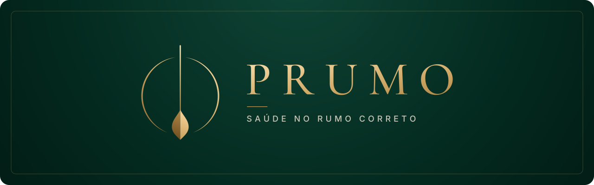
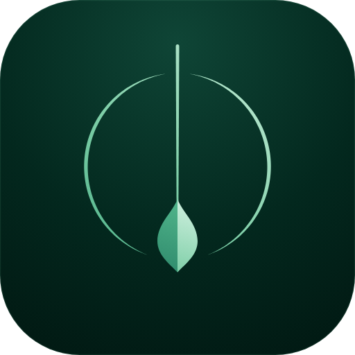
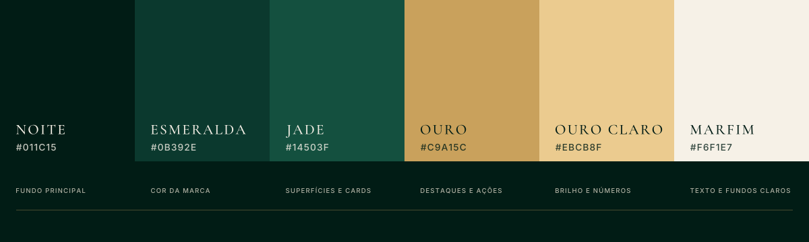

<p align="center">
  
</p>

<p align="center">
  Um coach de bem-estar com IA que transforma os hábitos do seu dia num pequeno plano de ação.<br>
  Projeto do <a href="https://fmu-tech-inovacao-20262.vercel.app/">FMU Tech Inovação 2026.2</a> · ODS 3: Saúde e Bem-Estar
</p>

---

> ⚠️ **O Prumo não substitui orientação médica.** É uma ferramenta de autopercepção e incentivo a hábitos saudáveis.

## Status

🟡 **Checkpoint 1: Ideação** (19/10 a 30/10/2026). Ainda não há código. Este repositório reúne a proposta do projeto.

## Pitch

Quase um terço dos adultos do mundo não se movimenta o suficiente, e boa parte das pessoas dorme pouco, passa horas na tela e come mal sem perceber o quanto isso pesa na energia do dia a dia. O **Prumo** responde a uma pergunta simples, "como estou hoje?": em menos de um minuto o usuário registra sono, atividade, água, alimentação, humor e tempo de tela, e recebe um retrato do seu dia com uma ou duas sugestões práticas. As notas são calculadas por regras transparentes, comparando o usuário com o próprio padrão e com **dados públicos reais** (OMS, Guia Alimentar, Vigitel e PNS), e um modelo de linguagem apenas traduz esses números em conselhos claros, sem inventar dados.

→ [Pitch completo](docs/05-pitch.md)

## O problema

Adultos sedentários sabem que precisam mudar de hábitos, mas não enxergam a própria rotina com clareza nem conseguem transformar recomendações genéricas em ações concretas para o dia de hoje.

- **Público-alvo:** adultos sedentários (18 a 59 anos) que buscam uma vida mais saudável. *(O recorte para universitários está em avaliação pelo grupo.)*
- **ODS 3, meta 3.4:** prevenção de doenças crônicas não transmissíveis e promoção do bem-estar.

→ [Definição completa do problema](docs/01-problema.md)

## Bases de dados públicas

| Base | Responsável | Uso no Prumo |
|---|---|---|
| Vigitel | Ministério da Saúde | Comparação com adultos das capitais (atividade, tela, alimentação) |
| PNS 2019 | IBGE | Comparação nacional e por região |
| Diretrizes de atividade física (2020) | OMS | Meta semanal de 150 a 300 min |
| Guia Alimentar para a População Brasileira | Ministério da Saúde | Avaliação da alimentação |

→ [Detalhes, indicadores e links](docs/02-bases-de-dados.md)

## A solução

```
Login ─► Registrar o dia ─► Análise da IA ─► Histórico e gráficos
```

A decisão central é **separar o cálculo da explicação**: o código calcula as notas com regras fixas (comparando com a média dos últimos 7 dias do usuário e com as metas oficiais), e o LLM só transforma esses números num card "Seu dia" com 1 ou 2 sugestões. Um chatbot que conhece o histórico do usuário completa a experiência.

| Camada | Tecnologia |
|---|---|
| Front-end | React + TypeScript (Vite), web responsivo, Recharts |
| API | Python (local; alvo: API Gateway + AWS Lambda) |
| Banco | Local no desenvolvimento; alvo: DynamoDB |
| Login | Alvo: Amazon Cognito |
| IA | Amazon Bedrock (Claude Haiku ou Nova Micro), com modo mock para desenvolvimento |

→ [Proposta completa, regras de pontuação, justificativas e LGPD](docs/03-solucao.md)

## Identidade visual



Ícone minimalista inspirado no **fio de prumo**, que representa **equilíbrio, alinhamento e direção**. Ele transmite foco, estabilidade e a ideia de estar no caminho correto. Ouro sobre verde-esmeralda profundo e tipografia serifada dão à marca um posicionamento de **alto nível**.



- **Cores:** Noite `#011C15`, Esmeralda `#0B392E`, Jade `#14503F`, Ouro `#C9A15C`, Ouro claro `#EBCB8F`, Marfim `#F6F1E7`
- **Tipografia:** Cormorant Garamond (logo e títulos) e Inter (texto e interface)

→ [Guia de identidade visual completo](docs/04-identidade-visual.md)

## Estrutura do repositório

```
.
├── README.md
├── assets/
│   └── brand/          # logo, símbolo, ícone do app e paleta (SVG)
│       └── png/        # exportações em PNG e o ícone original
└── docs/
    ├── 01-problema.md
    ├── 02-bases-de-dados.md
    ├── 03-solucao.md
    ├── 04-identidade-visual.md
    └── 05-pitch.md
```

## Cronograma

| Período | Etapa | Status |
|---|---|---|
| 19/10 a 30/10 | Checkpoint 1: Ideação | 🟡 em andamento |
| 09/11 a 27/11 | Checkpoint 2: Protótipo funcional, README com prints e vídeo | ⚪ |
| 07 e 08/12 | Apresentação final à banca | ⚪ |

## Equipe

| Integrante | Papel |
|---|---|
| Guilherme Geronymo | _a definir_ |
| _a definir_ | _a definir_ |

**Professor mentor:** _a definir_

## Licença

_A definir pelo grupo._
