<p align="center">
  
</p>

<p align="center">
  Um coach de bem-estar com IA que transforma os hábitos do seu dia num pequeno plano de ação.<br>
  Projeto do <a href="https://fmu-tech-inovacao-20262.vercel.app/">FMU Tech Inovação 2026.2</a> · ODS 3: Saúde e Bem-Estar
</p>

---

> ⚠️ **O Prumo não substitui orientação médica.** É uma ferramenta de autopercepção e incentivo a hábitos saudáveis.

## Status

🟡 **Checkpoint 2: protótipo funcional** (09/11 a 27/11/2026). O app está no ar em **https://app.healthprumo.online**, com a API em `https://api.healthprumo.online`. O app Android pode ser baixado em **https://download.healthprumo.online**. Código em [prumo-web](https://github.com/Health-Prumo/prumo-web), [prumo-mobile](https://github.com/Health-Prumo/prumo-mobile) e [prumo-api](https://github.com/Health-Prumo/prumo-api). Este repositório reúne a proposta, os docs e a identidade visual.

## Pitch

Quase um terço dos adultos do mundo não se movimenta o suficiente, e boa parte das pessoas dorme pouco, passa horas na tela e come mal sem perceber o quanto isso pesa na energia do dia a dia. O **Prumo** responde a uma pergunta simples, "como estou hoje?": em menos de um minuto o usuário registra sono, atividade, água, alimentação, humor e tempo de tela, e recebe um retrato do seu dia com uma ou duas sugestões práticas. As notas são calculadas por regras transparentes, comparando o usuário com o próprio padrão e com **dados públicos reais** (OMS, Guia Alimentar, Vigitel e PNS), e um modelo de linguagem apenas traduz esses números em conselhos claros, sem inventar dados.

→ [Pitch completo](docs/05-pitch.md)

## O app funcionando

Prints do app no ar, no celular (web e Android) e no computador. Os dados são de uma usuária fictícia, com 14 dias de registros de exemplo. As respostas do Coach vêm do modo de teste da API.

<table>
  <tr>
    <td align="center" width="25%"><br><b>Abertura</b><br><sub>Fio de prumo animado</sub></td>
    <td align="center" width="25%">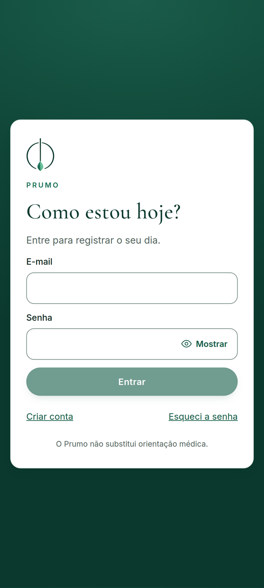<br><b>Entrar</b><br><sub>Login com Amazon Cognito</sub></td>
    <td align="center" width="25%">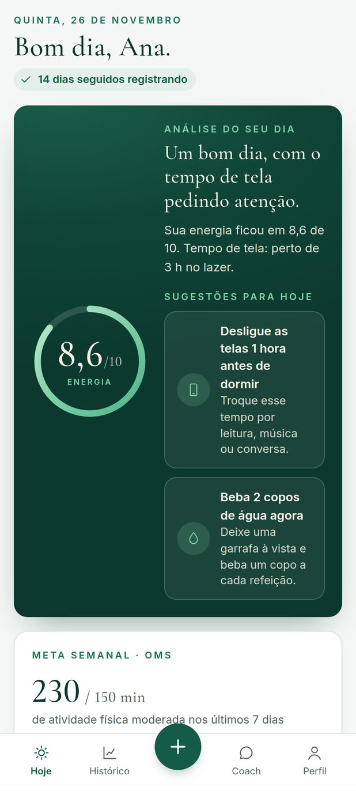<br><b>Hoje</b><br><sub>Nota de energia e sugestões</sub></td>
    <td align="center" width="25%">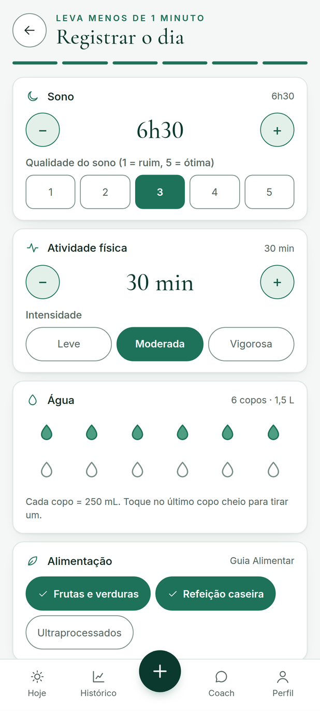<br><b>Registrar o dia</b><br><sub>Menos de 1 minuto</sub></td>
  </tr>
  <tr>
    <td align="center">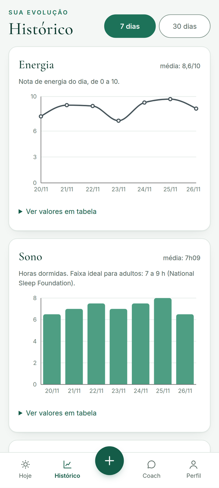<br><b>Histórico</b><br><sub>Evolução em 7 e 30 dias</sub></td>
    <td align="center">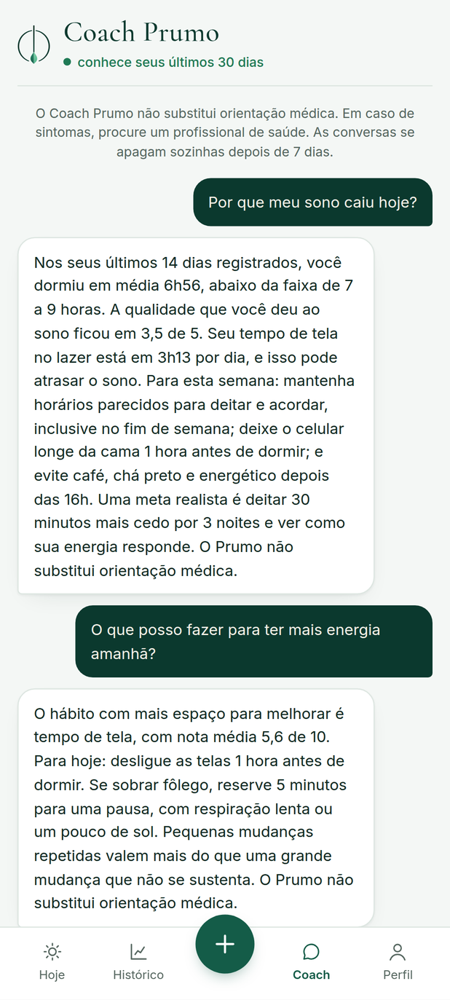<br><b>Coach IA</b><br><sub>Conhece os últimos 30 dias</sub></td>
    <td align="center">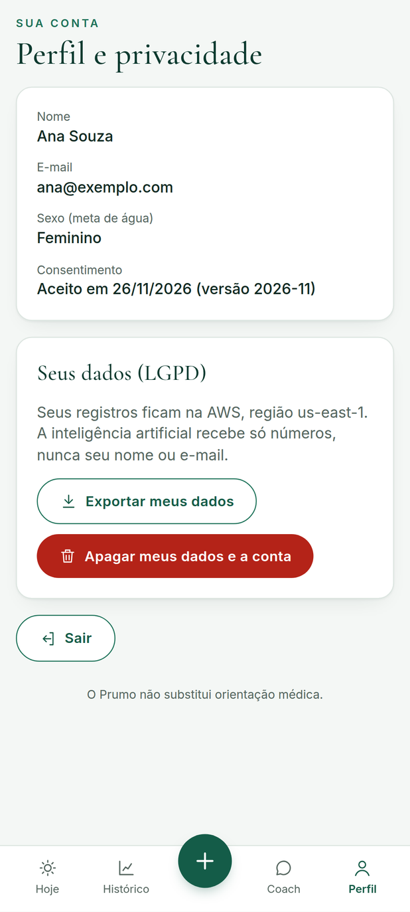<br><b>Perfil e privacidade</b><br><sub>Exportar e apagar (LGPD)</sub></td>
    <td align="center" valign="middle"><b>Experimente</b><br><br><a href="https://app.healthprumo.online">app.healthprumo.online</a><br><sub>no navegador</sub><br><br><a href="https://download.healthprumo.online">download.healthprumo.online</a><br><sub>app Android</sub></td>
  </tr>
</table>

**No computador: tela Hoje**

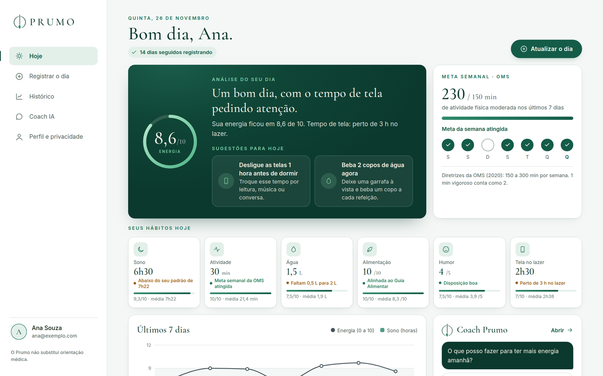

**No computador: Histórico**

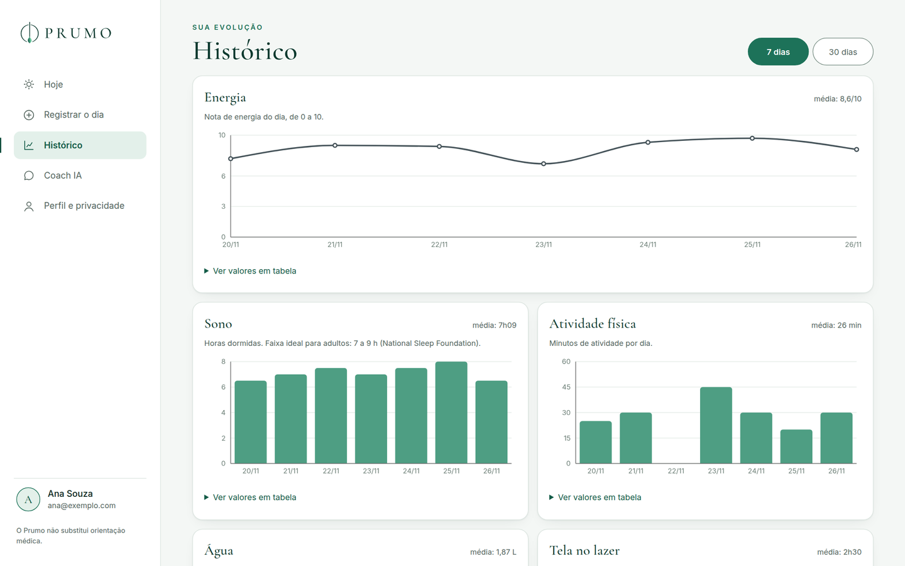

No Android, o login fica salvo entre uma abertura e outra. Quando sai versão nova, o app avisa e atualiza com um toque, sem desinstalar.

## O problema

Adultos sedentários sabem que precisam mudar de hábitos, mas não enxergam a própria rotina com clareza nem conseguem transformar recomendações genéricas em ações concretas para o dia de hoje.

- **Público-alvo:** adultos sedentários (18 a 59 anos) que buscam uma vida mais saudável. _(O recorte para universitários está em avaliação pelo grupo.)_
- **ODS 3, meta 3.4:** prevenção de doenças crônicas não transmissíveis e promoção do bem-estar.

→ [Definição completa do problema](docs/01-problema.md)

## Bases de dados públicas

| Base                                       | Responsável         | Uso no Prumo                                                       |
| ------------------------------------------ | ------------------- | ------------------------------------------------------------------ |
| Vigitel                                    | Ministério da Saúde | Comparação com adultos das capitais (atividade, tela, alimentação) |
| PNS 2019                                   | IBGE                | Comparação nacional e por região                                   |
| Diretrizes de atividade física (2020)      | OMS                 | Meta semanal de 150 a 300 min                                      |
| Guia Alimentar para a População Brasileira | Ministério da Saúde | Avaliação da alimentação                                           |

→ [Detalhes, indicadores e links](docs/02-bases-de-dados.md)

→ [Pesquisa inicial de fontes para o RAG](docs/07-pesquisa-rag.md) — artigos e guias candidatos para embasar explicações e sugestões; curadoria em avaliação.

## A solução

```
Login ─► Registrar o dia ─► Análise da IA ─► Histórico e gráficos
```

A decisão central é **separar o cálculo da explicação**: o código calcula as notas com regras fixas (comparando com a média dos últimos 7 dias do usuário e com as metas oficiais), e o LLM só transforma esses números num card "Seu dia" com 1 ou 2 sugestões. Um chatbot que conhece o histórico do usuário completa a experiência.

| Camada      | Tecnologia                                                                  |
| ----------- | --------------------------------------------------------------------------- |
| Front-end   | React + TypeScript (Vite), web responsivo, Recharts                         |
| App Android | Capacitor 8 sobre o mesmo front, APK em download.healthprumo.online         |
| API         | Python no AWS Lambda, atrás do API Gateway (HTTP API)                       |
| Banco       | Amazon DynamoDB (tabela única)                                              |
| Login       | Amazon Cognito                                                              |
| IA          | Amazon Bedrock com Amazon Nova Micro, com modo mock para desenvolvimento    |

→ [Proposta completa, regras de pontuação, justificativas e LGPD](docs/03-solucao.md)

### Infraestrutura na AWS

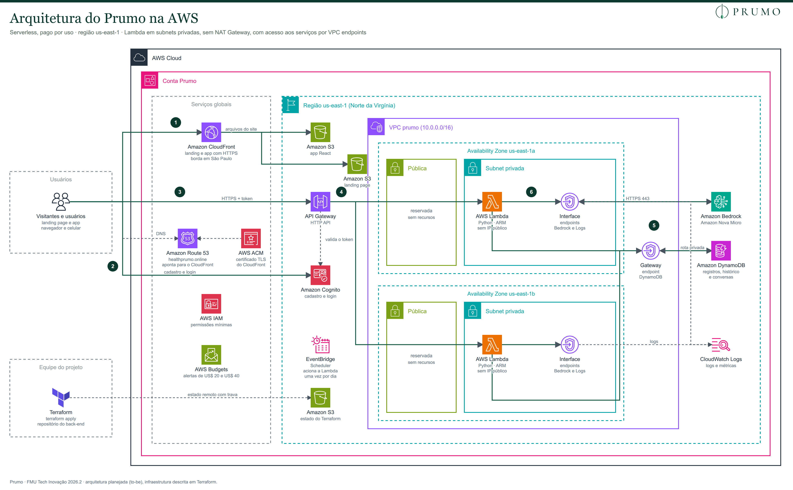

Arquitetura serverless em `us-east-1`, com a Lambda em subnets privadas de duas zonas de disponibilidade e acesso aos serviços da AWS por VPC endpoints, sem NAT Gateway. No cenário de teste (3 pessoas por 1 mês), o custo estimado é de **US$ 29,36 no mês**, coberto pelos créditos de conta nova.

→ [Serviços, decisões, custos e estimativa no formato da AWS Pricing Calculator](docs/06-infraestrutura-aws.md)

## Identidade visual

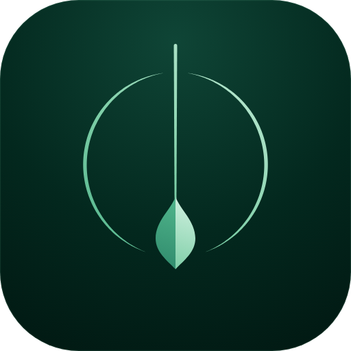

Ícone minimalista inspirado no **fio de prumo**, que representa **equilíbrio, alinhamento e direção**. Ele transmite foco, estabilidade e a ideia de estar no caminho correto. A interface segue o padrão de produtos de saúde: **base branca**, **verde-esmeralda como contraste** e menta como destaque.

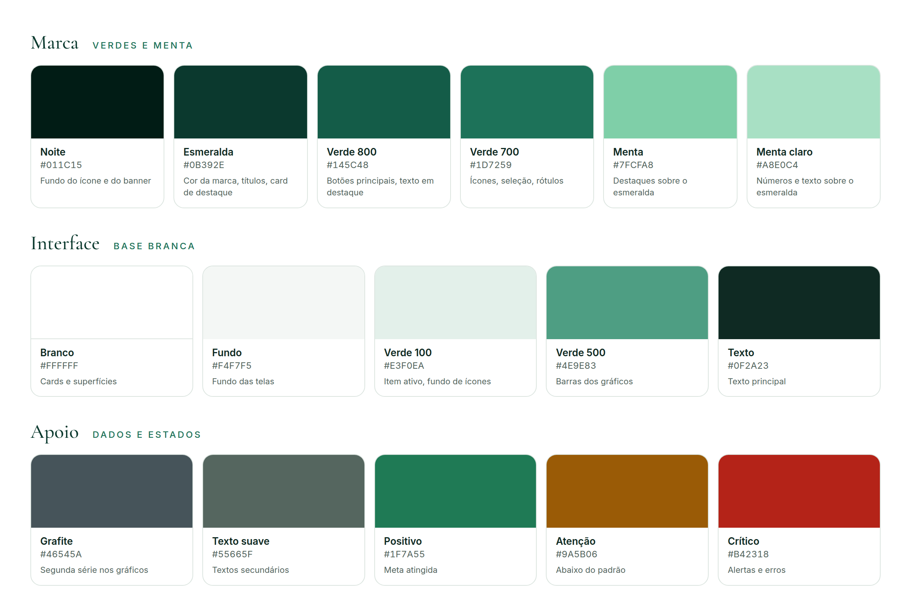

- **Cores principais:** Esmeralda `#0B392E`, Verde 800 `#145C48`, Verde 700 `#1D7259`, Menta `#7FCFA8`, Fundo `#F4F7F5`, Branco `#FFFFFF`
- **Tipografia:** Cormorant Garamond (logo e títulos) e Inter (texto e interface)

→ [Guia de identidade visual completo](docs/04-identidade-visual.md)

## Protótipo visual

Primeira proposta de interface, do Checkpoint 1, que serviu de base para o app. Os dados são fictícios.

**Web: tela inicial ("Hoje")**

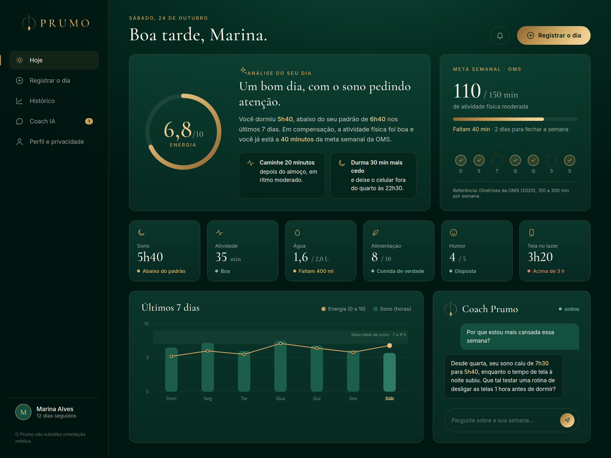

**Mobile: Hoje, Registrar o dia e Coach IA**

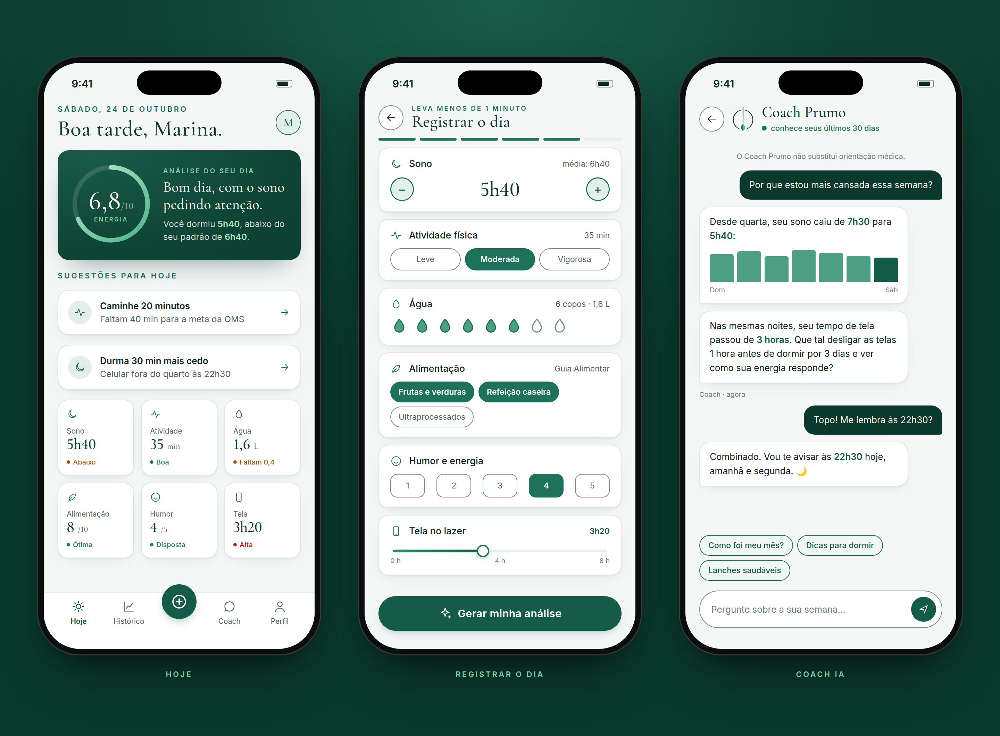

Os mockups são feitos em HTML e CSS, em [`assets/mockups/src/`](assets/mockups/src/), e servem de base para o front-end do Checkpoint 2.

## Estrutura do repositório

```
.
├── README.md
├── AGENTS.md           # contexto do projeto para agentes de IA (Claude Code, Codex)
├── CLAUDE.md           # importa o AGENTS.md
├── assets/
│   ├── brand/          # logo, símbolo e ícone do app (SVG)
│   │   ├── png/        # exportações em PNG, paleta e o ícone original
│   │   └── src/        # fonte da paleta em HTML
│   ├── prints/         # prints do app funcionando (celular e computador)
│   ├── mockups/        # protótipo visual (PNG)
│   │   └── src/        # fontes dos mockups em HTML e CSS
│   └── arquitetura/    # diagrama da arquitetura AWS (SVG e PNG)
└── docs/
    ├── 01-problema.md
    ├── 02-bases-de-dados.md
    ├── 03-solucao.md
    ├── 04-identidade-visual.md
    ├── 05-pitch.md
    ├── 06-infraestrutura-aws.md
    └── 07-pesquisa-rag.md
```

## Cronograma

| Período       | Etapa                                                        | Status          |
| ------------- | ------------------------------------------------------------ | --------------- |
| 19/10 a 30/10 | Checkpoint 1: Ideação                                        | 🟢 concluído    |
| 09/11 a 27/11 | Checkpoint 2: Protótipo funcional, README com prints e vídeo | 🟡 em andamento |
| 07 e 08/12    | Apresentação final à banca                                   | ⚪              |

## Equipe

| Integrante         |
| ------------------ |
| Guilherme Geronymo |
| Gabriel Ramos      |
| Eduardo Sannini    |

**Professor mentor:** _a definir_

## Licença

_A definir pelo grupo._
