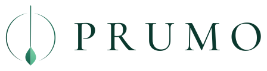
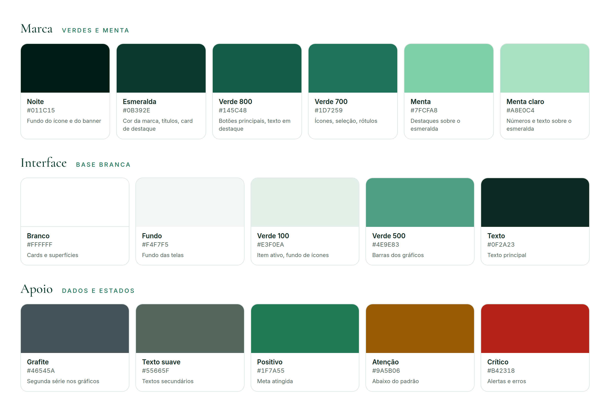

# 4. Identidade visual


## Conceito

**Prumo** é o instrumento (um peso preso a um fio) que indica a vertical exata. "Estar no prumo" significa estar alinhado, no caminho certo.

> O ícone é minimalista e inspirado no fio de prumo, que representa **equilíbrio, alinhamento e direção**. Ele transmite **foco, estabilidade** e a ideia de **estar no caminho correto**.

É exatamente o que o app oferece: um retrato diário que mostra se a rotina está alinhada e qual pequeno ajuste devolve a pessoa ao prumo.

**Lema:** *Saúde no rumo correto.* Aparece no banner e nos logos verticais. Dentro do app, a pergunta que guia o usuário continua sendo *"Como estou hoje?"*.

### Atributos da marca

| Atributo | Como aparece na marca |
|---|---|
| **Equilíbrio** | Símbolo perfeitamente simétrico: o fio vertical divide o anel ao meio e o peso repousa no centro. |
| **Alinhamento e direção** | A linha vertical aponta sempre para o mesmo lugar, como uma bússola do bem-estar. |
| **Foco e estabilidade** | Poucos elementos, traço fino e muito espaço livre. Nada distrai do essencial. |
| **Confiança e cuidado** | Base branca, verdes calmos e textos com alto contraste, como em serviços de saúde. A marca acolhe, não intimida. |

### Leitura do símbolo

- **O fio** é a linha de prumo, a referência do alinhamento e da direção certa.
- **O peso** dá estabilidade: é o ponto de equilíbrio que mantém o fio na vertical. Em verde-menta e dividido em luz e sombra, lembra uma **folha** e uma **gota** (natureza, corpo e crescimento).
- **O anel aberto** envolve o fio como um ciclo, o dia de 24 horas. As aberturas no topo e na base indicam que o ciclo nunca se fecha: todo dia é uma nova chance de ajuste.

## Logo

| Versão | Arquivo | Uso |
|---|---|---|
| Ícone do app | [`icone-app.svg`](../assets/brand/icone-app.svg) · [PNG 1024](../assets/brand/png/icone-app-1024.png) · [PNG 512](../assets/brand/png/icone-app-512.png) | Ícone do app, favicon, redes sociais |
| Horizontal, interface | [`logo-horizontal-app.svg`](../assets/brand/logo-horizontal-app.svg) | **Cabeçalho do app e do site.** Traço reforçado para ficar nítido em tamanho pequeno sobre branco. |
| Horizontal, fundo claro | [`logo-horizontal-fundo-claro.svg`](../assets/brand/logo-horizontal-fundo-claro.svg) · [PNG](../assets/brand/png/logo-horizontal-fundo-claro.png) | Documentos, slides claros (tamanho médio e grande) |
| Horizontal, fundo escuro | [`logo-horizontal.svg`](../assets/brand/logo-horizontal.svg) · [PNG](../assets/brand/png/logo-horizontal.png) | Slides e peças sobre esmeralda |
| Vertical, fundo claro | [`logo-vertical-fundo-claro.svg`](../assets/brand/logo-vertical-fundo-claro.svg) | Capa de documentos |
| Vertical, fundo escuro | [`logo-vertical.svg`](../assets/brand/logo-vertical.svg) | Tela de abertura, capa do pitch |
| Símbolo | [`simbolo-app.svg`](../assets/brand/simbolo-app.svg) · [`simbolo-fundo-claro.svg`](../assets/brand/simbolo-fundo-claro.svg) · [`simbolo.svg`](../assets/brand/simbolo.svg) | Avatar do Coach, carregamento, elemento gráfico |
| Monocromático | [`simbolo-mono-esmeralda.svg`](../assets/brand/simbolo-mono-esmeralda.svg) · [`simbolo-mono-marfim.svg`](../assets/brand/simbolo-mono-marfim.svg) | Gravação, impressão em uma cor, marca d'água |

<p>
  
</p>

Todos os arquivos são vetoriais. O nome "PRUMO" foi convertido em contornos, então o logo aparece igual em qualquer computador, mesmo sem as fontes instaladas.

### Regras de uso

- **Área de proteção:** manter ao redor do logo um espaço livre igual à largura do peso do pêndulo.
- **Tamanho mínimo:** símbolo com 24 px de altura na tela; logo horizontal com 120 px de largura. Abaixo de 200 px de largura, use a versão **interface** (`-app`).
- **Fundos claros** (branco, Fundo): versões `-fundo-claro` ou `-app`. **Fundos escuros** (Esmeralda, Noite): versões sem sufixo.
- **Não fazer:** distorcer, girar, aplicar sombra ou contorno, trocar as cores, colocar sobre fotos sem uma camada escura por baixo.

## Paleta de cores



A paleta segue o padrão de produtos de saúde: **base branca**, **verde como cor de contraste** e um único tom de destaque (menta) sobre o esmeralda. Referências: as paletas *Green Pharmacy*, *Healthy Living* e *Clinic Soft Green* do [GEC Designs](https://gecdesigns.com/color-palettes/healthcare) e as recomendações do [guia de design de apps de saúde da Mindster](https://mindster.com/mindster-blogs/healthcare-app-design-guide/) (cores calmas, confiança e acessibilidade WCAG 2.2).

### Marca

| Nome | Hex | Papel |
|---|---|---|
| **Noite** | `#011C15` | Fundo do ícone e do banner |
| **Esmeralda** | `#0B392E` | Cor da marca, títulos, card de destaque, mensagens do usuário no chat |
| **Verde 800** | `#145C48` | Botões principais, texto em destaque |
| **Verde 700** | `#1D7259` | Ícones, opções selecionadas, rótulos, barras de progresso |
| **Menta** | `#7FCFA8` | Destaques sobre o esmeralda (medidor de energia, ícones) |
| **Menta claro** | `#A8E0C4` | Números e texto em destaque sobre o esmeralda |

### Interface

| Nome | Hex | Papel |
|---|---|---|
| **Branco** | `#FFFFFF` | Cards, menu e barras |
| **Fundo** | `#F4F7F5` | Fundo das telas (branco levemente esverdeado) |
| **Verde 100** | `#E3F0EA` | Item ativo do menu, fundo dos ícones |
| **Verde 500** | `#4E9E83` | Barras dos gráficos |
| **Borda de controle** | `#788E84` | Bordas de campos e opções não selecionadas |
| **Texto** | `#0F2A23` | Texto principal |
| **Texto suave** | `#55665F` | Textos secundários |
| **Grafite** | `#46545A` | Segunda série de dados nos gráficos (energia) |

### Estados

| Estado | Hex | Uso |
|---|---|---|
| Positivo | `#1F7A55` | Meta atingida, hábito bom |
| Atenção | `#9A5B06` | Abaixo do padrão |
| Crítico | `#B42318` | Alertas e erros (só para isso) |

Os estados aparecem **sempre com texto** ("Boa", "Abaixo do padrão", "Acima de 3 h"), nunca só pela cor, para não depender da distinção entre verde e vermelho (daltonismo).

**Proporção de uso:** cerca de 70% branco e Fundo, 25% verdes e 5% menta. A menta só aparece sobre o esmeralda.

### Contraste (WCAG 2.2)

Texto precisa de 4,5:1 (AA). Elementos gráficos e bordas de controles precisam de 3:1 (critério 1.4.11).

| Combinação | Contraste | Resultado |
|---|---|---|
| Texto sobre branco | 15,3:1 | AAA |
| Esmeralda sobre branco | 12,8:1 | AAA |
| Branco sobre Verde 800 (botões) | 7,9:1 | AAA |
| Verde 700 sobre branco | 5,8:1 | AA |
| Texto suave sobre branco | 6,1:1 | AA |
| Menta claro sobre esmeralda | 7,3:1 | AAA |
| Menta sobre esmeralda | 5,9:1 | AA |
| Verde 500 (barras) sobre branco | 3,2:1 | ✓ elemento gráfico |
| Borda de controle sobre branco | 3,5:1 | ✓ elemento gráfico |
| Positivo / Atenção / Crítico sobre branco | 5,3 / 5,4 / 6,6:1 | AA |

## Tipografia

Ambas são gratuitas (licença SIL Open Font License) e estão no Google Fonts.

| Função | Fonte | Pesos | Por que |
|---|---|---|---|
| Logo, títulos e números grandes | **Cormorant Garamond** | 500, 600 | Serifada de inspiração clássica. Dá personalidade e calma aos títulos e aos números do dia. |
| Texto, interface e rótulos | **Inter** | 400, 500, 600 | Feita para telas, muito legível em tamanhos pequenos. |

**Regras:**

- Títulos em Cormorant Garamond, em caixa alta e com espaçamento entre letras de 0,15 a 0,2 em (como no logo) ou em caixa normal para títulos longos.
- Números em Cormorant Garamond com algarismos alinhados (`font-variant-numeric: lining-nums`).
- Rótulos pequenos (categorias, legendas) em Inter 600, caixa alta, 11 a 12 px, espaçamento de 0,2 em, em Verde 700.
- Texto corrido em Inter 400, 15 a 16 px, entrelinha de 1,6.

```css
@import url('https://fonts.googleapis.com/css2?family=Cormorant+Garamond:wght@500;600&family=Inter:wght@400;500;600&display=swap');

:root {
  /* marca */
  --cor-noite: #011C15;
  --cor-esmeralda: #0B392E;
  --cor-menta: #7FCFA8;
  --cor-menta-claro: #A8E0C4;
  --cor-grafite: #46545A;

  /* interface */
  --fundo: #F4F7F5;
  --superficie: #FFFFFF;
  --borda: #DCE5E0;
  --borda-controle: #788E84;
  --texto: #0F2A23;
  --texto-suave: #55665F;

  /* escala de verdes */
  --verde-50: #F1F7F4;
  --verde-100: #E3F0EA;
  --verde-500: #4E9E83;
  --verde-700: #1D7259;
  --verde-800: #145C48;

  /* estados */
  --cor-positivo: #1F7A55;
  --cor-atencao: #9A5B06;
  --cor-critico: #B42318;

  /* tipografia */
  --fonte-titulo: 'Cormorant Garamond', Georgia, serif;
  --fonte-texto: 'Inter', system-ui, sans-serif;
}
```

O arquivo completo, usado nos mockups, está em [`assets/mockups/src/prumo.css`](../assets/mockups/src/prumo.css).

## Elementos gráficos

- **Um card de destaque por tela** em esmeralda (por exemplo, "Seu dia"). O resto é branco.
- **Botões principais** em Verde 800 com texto branco. Opções selecionadas em Verde 700 sólido com texto branco.
- **Cantos arredondados** discretos: 12 px em cards, 16 px em painéis, botões em formato de pílula.
- **Ícones** com traço fino (1,5 px) em Verde 700, sobre um quadrado de Verde 100 quando precisam de destaque.
- **Sombras** suaves e curtas, só para separar os cards do fundo.

## Tom de voz

A marca fala como um **guia de bem-estar**: atento, calmo e preciso.

- **Acolhedor, nunca culpabilizante:** "seu sono ficou abaixo do seu padrão" em vez de "você dormiu mal".
- **Concreto:** sugestões com tempo e ação ("caminhe 20 minutos depois do almoço"), não conselhos vagos.
- **Simples e econômico:** frases curtas, sem gírias, sem excesso de emojis nem de pontos de exclamação.
- **Honesto:** sempre lembra que o app não substitui orientação médica.

## Evolução da identidade

A primeira versão da marca partiu do [ícone original](../assets/brand/png/icone-original.png): pêndulo dourado sobre verde-esmeralda escuro, com posicionamento de "luxo". Ao testar a interface, o grupo mudou a direção:

1. **Fundo escuro → base branca.** Apps e sites de saúde tendem a ser claros, o que transmite limpeza e confiança e facilita a leitura.
2. **Dourado → verde e menta.** O dourado reforçava exclusividade e preço alto, o oposto da proposta (hábitos saudáveis acessíveis, ODS 3). Sobre branco, também tinha contraste baixo (2:1). O símbolo manteve a forma e trocou o ouro por esmeralda e menta.
3. **Contraste revisado.** Barras de gráfico e bordas de campos passaram a cumprir o mínimo de 3:1 do WCAG 2.2.
4. **Logo para interface.** Criada uma versão com traço reforçado, porque o traço fino do símbolo perdia definição em tamanho pequeno.
