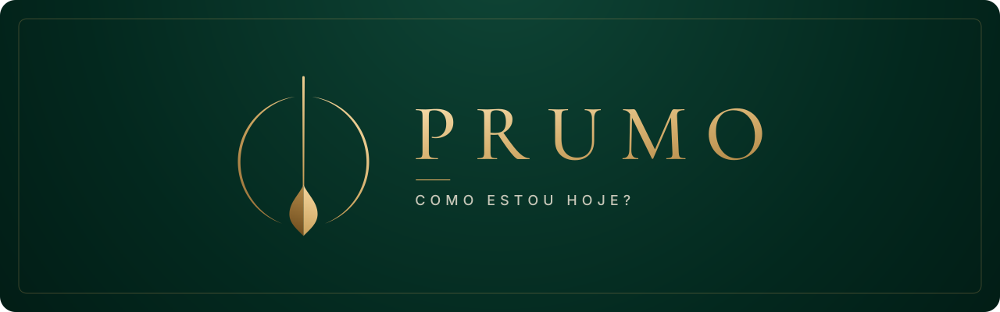

# 4. Identidade visual



## Conceito

**Prumo** é o instrumento (um peso preso a um fio) que indica a vertical exata. "Estar no prumo" significa estar alinhado, no caminho certo.

> O ícone é minimalista e inspirado no fio de prumo, que representa **equilíbrio, alinhamento e direção**. Ele transmite **foco, estabilidade** e a ideia de **estar no caminho correto**.

É exatamente o que o app oferece: um retrato diário que mostra se a rotina está alinhada e qual pequeno ajuste devolve a pessoa ao prumo.

### Atributos da marca

| Atributo | Como aparece na marca |
|---|---|
| **Equilíbrio** | Símbolo perfeitamente simétrico: o fio vertical divide o anel ao meio e o peso repousa no centro. |
| **Alinhamento e direção** | A linha vertical aponta sempre para o mesmo lugar, como uma bússola do bem-estar. |
| **Foco e estabilidade** | Poucos elementos, traço fino e muito espaço livre. Nada distrai do essencial. |
| **Alto nível e luxo** | Ouro sobre verde-esmeralda profundo, com tipografia serifada clássica e espaçada. Cuidar da saúde é tratado como privilégio, não como obrigação. |

### Leitura do símbolo

- **O fio** é a linha de prumo, a referência do alinhamento e da direção certa.
- **O peso** dá estabilidade: é o ponto de equilíbrio que mantém o fio na vertical. Dividido em luz e sombra, também lembra uma gota e uma folha (corpo e natureza).
- **O anel aberto** envolve o fio como um ciclo, o dia de 24 horas. As aberturas no topo e na base indicam que o ciclo nunca se fecha: todo dia é uma nova chance de ajuste.

## Logo

| Versão | Arquivo | Uso |
|---|---|---|
| Ícone do app | [`icone-app.svg`](../assets/brand/icone-app.svg) · [PNG 1024](../assets/brand/png/icone-app-1024.png) · [PNG 512](../assets/brand/png/icone-app-512.png) | Ícone do app, favicon, avatar do chatbot, redes sociais |
| Horizontal, fundo escuro | [`logo-horizontal.svg`](../assets/brand/logo-horizontal.svg) · [PNG](../assets/brand/png/logo-horizontal.png) | Cabeçalho do app, slides |
| Horizontal, fundo claro | [`logo-horizontal-fundo-claro.svg`](../assets/brand/logo-horizontal-fundo-claro.svg) · [PNG](../assets/brand/png/logo-horizontal-fundo-claro.png) | Documentos, papel timbrado |
| Vertical, fundo escuro | [`logo-vertical.svg`](../assets/brand/logo-vertical.svg) | Tela de abertura, capa do pitch |
| Vertical, fundo claro | [`logo-vertical-fundo-claro.svg`](../assets/brand/logo-vertical-fundo-claro.svg) | Capa de documentos |
| Símbolo | [`simbolo.svg`](../assets/brand/simbolo.svg) · [`simbolo-fundo-claro.svg`](../assets/brand/simbolo-fundo-claro.svg) | Elemento gráfico, carregamento |
| Monocromático | [`simbolo-mono-marfim.svg`](../assets/brand/simbolo-mono-marfim.svg) · [`simbolo-mono-esmeralda.svg`](../assets/brand/simbolo-mono-esmeralda.svg) | Gravação, impressão em uma cor, marca d'água |

<p>
  
</p>

Todos os arquivos são vetoriais. O nome "PRUMO" foi convertido em contornos, então o logo aparece igual em qualquer computador, mesmo sem as fontes instaladas. O símbolo foi redesenhado em vetor a partir do [ícone original](../assets/brand/png/icone-original.png).

### Regras de uso

- **Área de proteção:** manter ao redor do logo um espaço livre igual à largura do peso do pêndulo.
- **Tamanho mínimo:** símbolo com 24 px de altura na tela; logo horizontal com 120 px de largura.
- **Em fundos escuros** (Noite, Esmeralda) use a versão em ouro. **Em fundos claros** (Marfim) use a versão com wordmark Esmeralda e ouro mais fechado.
- **Não fazer:** distorcer, girar, aplicar sombra ou contorno, trocar as cores, colocar sobre fotos sem uma camada escura por baixo, usar ouro sobre Marfim em textos.

## Paleta de cores


As cores foram extraídas do ícone original.

| Nome | Hex | Papel |
|---|---|---|
| **Noite** | `#011C15` | Fundo principal do app |
| **Esmeralda** | `#0B392E` | Cor da marca, fundos de destaque |
| **Jade** | `#14503F` | Superfícies, cards e campos de formulário |
| **Ouro** | `#C9A15C` | Ações principais, ícones, destaques |
| **Ouro claro** | `#EBCB8F` | Números em evidência (nota de energia), brilho dos degradês |
| **Marfim** | `#F6F1E7` | Texto sobre fundos escuros, fundo de documentos |

**Degradê ouro** (para o símbolo e títulos grandes): `#8C6430 → #C9A15C → #EBCB8F → #F7D69E`, na diagonal, com a luz vindo do canto superior direito.

**Proporção de uso:** cerca de 70% verdes (Noite, Esmeralda, Jade), 20% Marfim e 10% ouro. O ouro é a joia, não o tecido: quanto mais raro, mais valioso.

### Contraste (WCAG 2.1)

| Combinação | Contraste | Resultado |
|---|---|---|
| Marfim sobre Noite | 15,8:1 | AAA |
| Marfim sobre Esmeralda | 11,4:1 | AAA |
| Marfim sobre Jade | 8,3:1 | AAA |
| Ouro claro sobre Noite | 11,4:1 | AAA |
| Ouro sobre Noite | 7,4:1 | AAA |
| Ouro sobre Esmeralda | 5,3:1 | AA |
| Ouro sobre Jade | 3,9:1 | Só para texto grande (18 pt ou mais) e ícones |
| Esmeralda sobre Marfim | 11,4:1 | AAA |
| Ouro sobre Marfim | 2,1:1 | ❌ Não usar em texto |

### Cores de estado (interface)

Para não quebrar a elegância da paleta, os estados usam tons dessaturados:

| Estado | Hex | Uso |
|---|---|---|
| Positivo | `#7FB89A` | Meta atingida |
| Atenção | `#E0B25A` | Abaixo do padrão |
| Crítico | `#D9826B` | Muito abaixo da meta, erros |

## Tipografia

Ambas são gratuitas (licença SIL Open Font License) e estão no Google Fonts.

| Função | Fonte | Pesos | Por que |
|---|---|---|---|
| Logo, títulos e números grandes | **Cormorant Garamond** | 500, 600 | Serifada de inspiração clássica, alto contraste entre traços finos e grossos. É a linguagem tipográfica das marcas de luxo. |
| Texto, interface e rótulos | **Inter** | 400, 500, 600 | Feita para telas, muito legível em tamanhos pequenos. Equilibra a serifada com precisão moderna. |

**Regras:**

- Títulos em Cormorant Garamond, em caixa alta e com espaçamento entre letras de 0,15 a 0,2 em (como no logo) ou em caixa normal para títulos longos.
- Rótulos pequenos (categorias, legendas) em Inter 500, caixa alta, 11 a 12 px, espaçamento de 0,2 em.
- Texto corrido em Inter 400, 15 a 16 px, entrelinha de 1,6.

```css
@import url('https://fonts.googleapis.com/css2?family=Cormorant+Garamond:wght@500;600&family=Inter:wght@400;500;600&display=swap');

:root {
  /* marca */
  --cor-noite: #011C15;
  --cor-esmeralda: #0B392E;
  --cor-jade: #14503F;
  --cor-ouro: #C9A15C;
  --cor-ouro-claro: #EBCB8F;
  --cor-marfim: #F6F1E7;
  --degrade-ouro: linear-gradient(135deg, #8C6430 0%, #C9A15C 45%, #EBCB8F 80%, #F7D69E 100%);

  /* estados */
  --cor-positivo: #7FB89A;
  --cor-atencao: #E0B25A;
  --cor-critico: #D9826B;

  /* tipografia */
  --fonte-titulo: 'Cormorant Garamond', Georgia, serif;
  --fonte-texto: 'Inter', system-ui, sans-serif;
  --espacamento-titulo: 0.18em;
  --espacamento-rotulo: 0.2em;
}
```

## Elementos gráficos

- **Linhas finas em ouro** (1 px, 30% de opacidade) como divisores e molduras, como no banner.
- **Cantos arredondados** discretos: 12 px em cards, 20 px em painéis.
- **Fundos** com um leve degradê radial de Esmeralda (no topo) para Noite (nas bordas), como no ícone.
- **Ícones** com traço fino (1,5 px) em ouro ou marfim, sem preenchimento.

## Tom de voz

A marca fala como um **concierge de bem-estar**: atento, discreto e preciso.

- **Acolhedor, nunca culpabilizante:** "seu sono ficou abaixo do seu padrão" em vez de "você dormiu mal".
- **Concreto:** sugestões com tempo e ação ("caminhe 20 minutos depois do almoço"), não conselhos vagos.
- **Elegante e econômico:** frases curtas, sem gírias, sem excesso de emojis nem de pontos de exclamação.
- **Honesto:** sempre lembra que o app não substitui orientação médica.
