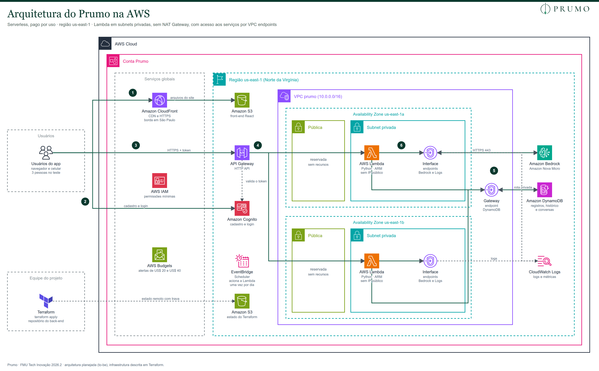

# 6. Infraestrutura na AWS (serverless)

Levantamento dos serviços da AWS para a primeira versão do Prumo, com custo estimado para a fase de validação (hackathon e apresentação à banca). O objetivo é rodar o projeto inteiro **dentro dos créditos de conta nova da AWS**, sem nenhuma cobrança no cartão.

- **Região:** `us-east-1` (Norte da Virgínia)
- **Preços:** oficiais, da [AWS Price List API](https://pricing.us-east-1.amazonaws.com/offers/v1.0/aws/index.json), publicação de 30/10/2026

## Resumo

| | |
|---|---|
| **Custo do teste** (3 usuários por 1 mês) | **US$ 29,36 no mês**, coberto pelos créditos. **Custo real: zero.** |
| **Maior custo** | Os VPC endpoints da rede privada (US$ 29,20 por mês). O uso do app em si custa centavos. |
| **Créditos** | US$ 100 garantidos, mais até US$ 100 com atividades guiadas. Com US$ 200, cobrem os 6 meses do plano Free. |
| **Conta** | `health-prumo` (444331926746), criada em 11/11/2026, região `us-east-1` |
| **Plano da conta** | **Free**: nunca gera cobrança e dura até 6 meses (até 11/05/2027), o que cobre todo o semestre. |
| **Infraestrutura como código** | Terraform + Terragrunt em [tf-blueprint](https://github.com/Health-Prumo/tf-blueprint) e [tf-environments](https://github.com/Health-Prumo/tf-environments) |
| **Modelo de IA** | **Amazon Nova Micro**. O Claude no Bedrock é cobrado pelo AWS Marketplace, que os créditos não cobrem. |

## Arquitetura

Ícones oficiais do pacote AWS Architecture Icons. Versão vetorial: [`assets/arquitetura/arquitetura-aws.svg`](../assets/arquitetura/arquitetura-aws.svg).

O fluxo principal (registrar o dia e receber a análise), numerado no diagrama, passa por:
1. **CloudFront e S3:** entregam o site.
2. **Cognito:** faz o login e emite um token.
3. **API Gateway:** recebe a chamada do app e confere o token no Cognito.
4. **Lambda:** roda dentro das subnets privadas da VPC, nas duas zonas de disponibilidade.
5. **DynamoDB:** a Lambda grava o dia e lê os últimos 7 dias pelo gateway endpoint, sem sair para a internet. Depois calcula as notas pelas regras fixas.
6. **Bedrock:** a Lambda manda só os números já calculados pelo interface endpoint e recebe o texto do card "Seu dia".

Não há servidor ligado o tempo todo. Os serviços são cobrados por uso, e só os VPC endpoints têm custo fixo por hora.

### Rede (VPC)

| Boa prática | Como aparece no Prumo |
|---|---|
| **Alta disponibilidade** | VPC `10.0.0.0/16` com subnets em duas zonas de disponibilidade (`us-east-1a` e `us-east-1b`) |
| **Nada exposto à internet** | A Lambda roda só nas subnets privadas, sem IP público |
| **Sem NAT Gateway** | O acesso aos serviços da AWS sai por **VPC endpoints**, pela rede privada da AWS, sem passar pela internet |
| **DynamoDB por gateway endpoint** | Gratuito, associado às tabelas de rotas das subnets privadas |
| **Bedrock e CloudWatch Logs por interface endpoints** | Um de cada por zona (4 no total), com security group que só aceita HTTPS (porta 443) vindo da Lambda |
| **Subnets públicas reservadas** | Ficam criadas e vazias, prontas para um balanceador de carga ou NAT no futuro |
| **Menor privilégio** | Security group da Lambda sem regras de entrada; papel do IAM com acesso só à tabela do DynamoDB, ao modelo do Bedrock e aos próprios logs |

O API Gateway, o Cognito, o S3 e o CloudFront são serviços gerenciados que ficam fora da VPC, como recomenda a AWS.

## Serviços

| Serviço | Papel no Prumo | Por que este | Nível gratuito permanente (por mês) |
|---|---|---|---|
| **Amazon S3** | Guarda os arquivos do front-end (React já compilado) | Hospedagem estática barata e simples | Não tem; sai dos créditos (centavos) |
| **Amazon CloudFront** | Entrega o site com HTTPS e cache | HTTPS gratuito, rápido no Brasil e protege o S3 | 1 TB de transferência e 10 milhões de requisições |
| **Amazon Cognito** | Cadastro, login e recuperação de senha | Login pronto e seguro, sem guardar senhas no nosso código | 10 mil usuários ativos (planos Lite e Essentials) |
| **API Gateway (HTTP API)** | Porta de entrada da API, valida o token do Cognito | HTTP API custa cerca de 70% menos que a REST API e já valida JWT | Não tem; sai dos créditos (centavos) |
| **AWS Lambda** | Backend em Python: registro, motor de pontuação, chamada à IA | Paga só quando executa; arquitetura ARM é 20% mais barata | 1 milhão de execuções e 400 mil GB-segundo |
| **Amazon DynamoDB** | Registros diários, histórico, conversas e perfil | Banco sem servidor; o acesso por usuário e data encaixa num modelo chave-valor | 25 GB de armazenamento |
| **Amazon Bedrock** | Gera o card "Seu dia" e as respostas do Coach | IA gerenciada, sem chave de API para guardar (acesso por permissão da Lambda) | **Não tem.** É o principal custo. |
| **EventBridge Scheduler** | Lembrete diário para registrar o dia | Agendamento sem servidor | 14 milhões de invocações |
| **CloudWatch Logs** | Logs da Lambda e da API para depuração | Já integrado à Lambda | 5 GB |
| **AWS Budgets** | Alertas por e-mail se o gasto passar de um limite | Proteção contra surpresas na fatura | Gratuito |
| **IAM** | Permissões mínimas para cada função | Obrigatório e gratuito | Gratuito |
| **Amazon VPC** | Rede privada da Lambda, com subnets em duas zonas | Isola o backend da internet | A VPC e o gateway endpoint são gratuitos; os interface endpoints, não |

### Infraestrutura como código

Toda a infraestrutura é descrita em código com **Terraform** (provider `hashicorp/aws`) e **Terragrunt**, em dois repositórios. Assim qualquer integrante recria o ambiente, e a banca vê exatamente o que existe na conta.

| Repositório | Conteúdo |
|---|---|
| [Health-Prumo/tf-blueprint](https://github.com/Health-Prumo/tf-blueprint) | Módulos Terraform reutilizáveis, versionados por tag (hoje `v0.2.0`). Cada módulo tem `versions.tf`, `variables.tf` com validações, `main.tf`, `outputs.tf` e `README.md`, e o GitHub Actions confere formatação e validação a cada push. |
| [Health-Prumo/tf-environments](https://github.com/Health-Prumo/tf-environments) | Os ambientes em Terragrunt. Cada ambiente tem um `root.hcl` com o estado remoto e o provider, e cada pasta dentro dele aponta para um módulo do `tf-blueprint` por tag, nunca pela `main`. |

**O que já está na conta (11/11/2026):** só as proteções de custo: o orçamento com alertas (`global/budgets`) e a detecção de anomalias (`global/cost-anomaly`). Os módulos de rede, banco, login, front-end e API entram no `tf-blueprint` quando a infra for provisionada, num ambiente `dev/`.

- **Estado remoto no bucket `prumo-terraform-state-444331926746`, com trava nativa (`use_lockfile = true`).** O estado fica no S3 para que os três integrantes trabalhem sobre o mesmo ambiente. A trava nativa do S3 dispensa a tabela do DynamoDB que se usava antes, e o custo é de centavos.
- **Bucket do estado criado pelo próprio Terragrunt** na primeira execução (`terragrunt init --backend-bootstrap`), com versionamento, criptografia e acesso público bloqueado. Ele não é gerenciado pelo mesmo código que ele guarda.
- **Proteção contra conta errada:** o provider tem `allowed_account_ids = ["444331926746"]`. Se outro perfil da AWS estiver ativo, o Terraform para antes de mudar qualquer coisa.
- **Tags padrão** em todos os recursos: `Projeto`, `Ambiente`, `GerenciadoPor` e `Repositorio`.
- **Nada sensível no repositório:** os e-mails dos alertas vêm das variáveis de ambiente `PRUMO_ALERT_EMAILS` e `PRUMO_ANOMALY_EMAILS`.
- **Código da Lambda empacotado pelo próprio Terraform** com `archive_file`. Assim um `terraform apply` publica a infraestrutura e o código juntos.
- **Bucket do front-end com `force_destroy = true`.** Isso permite que o `terraform destroy` apague o bucket mesmo com arquivos dentro.

### Modelo de dados (DynamoDB, tabela única)

| Chave de partição (`PK`) | Chave de ordenação (`SK`) | Conteúdo |
|---|---|---|
| `USUARIO#<id>` | `PERFIL` | Idade, sexo, metas, consentimento LGPD |
| `USUARIO#<id>` | `DIA#2026-10-31` | Registro do dia, notas calculadas e o texto da análise |
| `USUARIO#<id>` | `CHAT#<data e hora>` | Pergunta e resposta do Coach (expira em 90 dias por TTL) |

Uma consulta por usuário e intervalo de datas traz os últimos 7 ou 30 dias de uma vez, que é o que o histórico e o motor de pontuação precisam.

## Estimativa do teste (formato da AWS Pricing Calculator)

Cenário: **3 pessoas testando o app por 1 mês**, com uso intenso, e depois a infraestrutura é apagada. Cada uma abre o app 10 vezes por dia, pede 3 análises e manda 10 mensagens ao Coach. A tabela segue o formato da [AWS Pricing Calculator](https://calculator.aws/), com o nível gratuito incluído e valores arredondados para 2 casas, como o site faz.

| Serviço | Região | Custo inicial | Custo mensal | Custo em 12 meses | Resumo da configuração |
|---|---|---|---|---|---|
| AWS Lambda | US East (N. Virginia) | 0,00 USD | 0,00 USD | 0,00 USD | Arquitetura Arm; 5.670 requisições/mês; duração média 740 ms; 512 MB de memória; 512 MB de armazenamento temporário; nível gratuito incluído |
| Amazon API Gateway | US East (N. Virginia) | 0,00 USD | 0,01 USD | 0,07 USD | HTTP API; 5.670 requisições/mês; tamanho médio da requisição 2 KB |
| Amazon DynamoDB | US East (N. Virginia) | 0,00 USD | 0,00 USD | 0,03 USD | Tabela Standard sob demanda; 0,01 GB armazenados; tamanho médio do item 1 KB; 2.160 gravações e 9.000 leituras/mês |
| Amazon Cognito | US East (N. Virginia) | 0,00 USD | 0,00 USD | 0,00 USD | Plano Lite; 3 usuários ativos/mês; nível gratuito incluído |
| Amazon S3 | US East (N. Virginia) | 0,00 USD | 0,00 USD | 0,03 USD | S3 Standard; 0,05 GB; 300 PUT e 700 GET/mês |
| Amazon CloudFront | Global (América do Sul) | 0,00 USD | 0,00 USD | 0,00 USD | 0,22 GB de transferência/mês; 13.500 requisições HTTPS; nível gratuito incluído |
| Amazon CloudWatch | US East (N. Virginia) | 0,00 USD | 0,00 USD | 0,00 USD | Logs: 0,01 GB ingeridos/mês, padrão Standard; nível gratuito incluído |
| Amazon EventBridge | US East (N. Virginia) | 0,00 USD | 0,00 USD | 0,00 USD | Scheduler: 90 invocações/mês |
| Amazon Bedrock | US East (N. Virginia) | 0,00 USD | 0,14 USD | 1,73 USD | Amazon Nova Micro sob demanda; 2,66 milhões de tokens de entrada e 0,36 milhão de saída/mês |
| Amazon VPC | US East (N. Virginia) | 0,00 USD | 29,20 USD | 350,40 USD | 4 interface endpoints (Bedrock Runtime e CloudWatch Logs em 2 zonas), 730 horas/mês; 0,01 GB processados; 1 gateway endpoint do DynamoDB (gratuito) |
| **Total** | | **0,00 USD** | **29,36 USD** | **352,26 USD** | |

- **Duração média da Lambda (740 ms):** média ponderada entre chamadas comuns (150 ms) e chamadas que esperam a IA (3 s).
- **Custo em 12 meses:** é o formato padrão da AWS Pricing Calculator. Como o teste dura 1 mês e depois tudo é apagado, o custo real é o de um mês (**US$ 29,36**), pago pelos créditos.
- **Sem os VPC endpoints,** o mês sairia por US$ 0,16. Quase todo o custo é a rede privada.
- **Para economizar créditos:** os endpoints são cobrados por hora. Apagar a infraestrutura com `terraform destroy` nos dias sem teste e recriá-la com `terraform apply` reduz o gasto na mesma proporção. Com uma zona só, o custo cai pela metade (US$ 14,60), mas sem alta disponibilidade.
- **Com o Claude Haiku 5.5 no lugar do Nova Micro,** o Bedrock passaria para US$ 0,45 no mês, cobrado no cartão (exige plano Paid; ver [Decisões](#modelo-de-ia-amazon-nova-micro)).

**Para gerar o link oficial:** abra https://calculator.aws/, clique em **Create estimate** e adicione cada serviço da tabela com a região **US East (N. Virginia)** e os valores da coluna "Resumo da configuração". No fim, **Save and share** gera um link público que qualquer pessoa abre, sem precisar de conta.

### Depois do teste: apagar tudo

1. **Apagar a infraestrutura:** `terraform destroy` remove todos os recursos criados pelo Terraform.
2. **Conferir o bucket do front-end:** com `force_destroy = true` ele é apagado junto. Sem isso, o Terraform falha ao apagar um bucket com arquivos.
3. **Remover os logs:** a Lambda cria o próprio grupo de log (`/aws/lambda/...`) se ele não estiver declarado no Terraform. Declare o grupo com `aws_cloudwatch_log_group` para ele ser apagado junto, ou remova-o pelo console.
4. **Apagar o bucket do estado do Terraform:** por último, porque o `destroy` precisa dele.
5. **Encerrar a conta, se ela não for mais usada:** no plano Free, mesmo sem encerrar, nada é cobrado. A conta é suspensa ao fim dos 6 meses e apagada 90 dias depois.

## Preços oficiais usados (us-east-1)

| Serviço | Item | Preço |
|---|---|---|
| Lambda | Requisições | US$ 0,20 por milhão |
| Lambda | Processamento ARM (faixa 1) | US$ 0,0000133334 por GB-segundo |
| API Gateway | HTTP API (até 300 milhões) | US$ 1,00 por milhão de requisições |
| DynamoDB | Gravações sob demanda | US$ 0,625 por milhão |
| DynamoDB | Leituras sob demanda | US$ 0,125 por milhão |
| DynamoDB | Armazenamento acima de 25 GB | US$ 0,25 por GB-mês |
| Cognito | Plano Lite (acima de 10 mil usuários) | US$ 0,0055 por usuário ativo |
| Cognito | Plano Essentials (acima de 10 mil usuários) | US$ 0,015 por usuário ativo |
| S3 Standard | Armazenamento | US$ 0,023 por GB-mês |
| CloudFront | Transferência para a América do Sul | US$ 0,110 por GB |
| CloudFront | Requisições HTTPS na América do Sul | US$ 0,022 por 10 mil |
| CloudWatch Logs | Ingestão / armazenamento | US$ 0,50 por GB / US$ 0,03 por GB-mês |
| EventBridge Scheduler | Acima de 14 milhões | US$ 1,00 por milhão |
| VPC | Interface endpoint, por zona | US$ 0,01 por hora |
| VPC | Dados processados pelos endpoints (até 1 PB) | US$ 0,01 por GB |
| VPC | Gateway endpoint (DynamoDB e S3) | Gratuito |
| **Bedrock** | **Amazon Nova Micro** (entrada / saída) | **US$ 0,035 / US$ 0,14 por milhão de tokens** |
| Bedrock | Claude Haiku 5.5, global (entrada / saída) | US$ 0,10 / US$ 0,50 por milhão de tokens |
| Bedrock | Claude Haiku 4.5, global (entrada / saída) | US$ 1,00 / US$ 5,00 por milhão de tokens |

## Custo por cenário

**Premissas de uso:**
- **Uso do app:** cada usuário abre o app 4 vezes por dia (5 chamadas de API por abertura), pede 1 análise "Seu dia" e manda 4 mensagens ao Coach.
- **Tamanho da IA:** cada análise usa cerca de 1.500 tokens de entrada e 350 de saída; cada mensagem do Coach, 2.500 de entrada (com o resumo do histórico) e 300 de saída.
- **Lambda:** usa 512 MB de memória.

| Cenário | Usuários | Dias | VPC endpoints | Demais serviços após nível gratuito | Bedrock (Nova Micro) | **Total no mês** |
|---|---|---|---|---|---|---|
| **Teste (3 pessoas)** | 3 | 30 | US$ 29,20 | US$ 0,01 | US$ 0,14 | **US$ 29,36** |
| Desenvolvimento (equipe testando) | 5 | 30 | US$ 29,20 | US$ 0,02 | US$ 0,24 | **US$ 29,46** |
| Validação (hackathon) | 30 | 30 | US$ 29,20 | US$ 0,04 | US$ 0,56 | **US$ 29,79** |
| Crescimento (referência) | 1.000 | 30 | US$ 29,20 | US$ 1,13 | US$ 18,59 | **US$ 48,91** |

**Duração dos créditos:**
- **Com US$ 100:** a cerca de US$ 29,50 por mês, duram uns 3 meses e meio. Isso cobre o semestre, que termina em 08/12.
- **Com os US$ 200:** fazendo as atividades guiadas, cobrem os 6 meses inteiros do plano Free.
- **Ao acabarem:** no plano Free, nada é cobrado, mas a conta é suspensa.

**Na prática, o grupo não paga nada.**

## Decisões

### Região: us-east-1

- É a região com mais modelos no Bedrock e os menores preços.
- A diferença de latência para o Brasil não pesa num app de registro diário. O site em si é entregue pelos servidores do CloudFront em São Paulo.
- **LGPD:** os dados ficam nos Estados Unidos. A LGPD permite essa transferência internacional com consentimento específico e destacado do titular (art. 33, VIII). Por isso o termo de consentimento do cadastro informa onde os dados são armazenados.

### Plano da conta: Free

Desde julho de 2025, contas novas escolhem entre dois planos:

| | Plano Free | Plano Paid |
|---|---|---|
| Créditos | US$ 100, mais até US$ 100 com atividades guiadas | Os mesmos |
| Cobrança | **Nunca cobra** | Cobra o que passar dos créditos |
| Duração | Até 6 meses ou até os créditos acabarem | Sem limite |
| Ao terminar | Conta suspensa; dados guardados por 90 dias; depois disso, sem upgrade, a conta é apagada | — |
| Serviços | Alguns serviços caros ficam bloqueados | Todos |

O semestre termina em 08/12. Criando a conta agora, o plano Free cobre todo o projeto sem risco de cobrança. Se o projeto continuar depois, basta fazer upgrade para Paid antes dos 6 meses.

**Cuidado: a conta sai do Free sozinha e não volta.** Ativar **AWS Organizations**, **IAM Identity Center** ou **Control Tower** converte a conta para Paid na hora, e o upgrade não tem volta. Foi o que aconteceu com a primeira conta do projeto: o Identity Center criou uma Organization, a conta virou Paid sem créditos, e ela foi fechada. Por isso a conta atual usa **usuários IAM** e o acesso pela CLI é pelo `aws login`, sem chaves de acesso fixas.

### Modelo de IA: Amazon Nova Micro

- **Créditos:** os modelos da Anthropic (Claude) no Bedrock são cobrados pelo **AWS Marketplace**. Os termos dos créditos promocionais excluem cobranças do Marketplace, e há relatos de contas novas no plano Free recebendo erro de acesso a esses modelos.
- **Nova Micro:** é um modelo da própria AWS, então os créditos cobrem e ele funciona no plano Free. Também é o mais barato. Para escrever um card curto a partir de números já calculados, ele atende.
- **Troca de modelo:** o ID do modelo fica numa variável de ambiente da Lambda. Se o grupo quiser comparar com o Claude Haiku 5.5 (conta Paid, cobrado no cartão: cerca de US$ 1,77 no cenário de validação), basta trocar a variável.

## Cuidados para não gerar cobrança

**Serviços a evitar**, porque cobram por hora mesmo sem uso:
- **NAT Gateway:** US$ 0,045 por hora (cerca de US$ 33 por mês) mais US$ 0,045 por GB. Os VPC endpoints substituem o NAT.
- **RDS, Aurora e instâncias EC2:** o DynamoDB substitui o banco relacional.
- **Endereços IP públicos (IPv4) parados.**
- **AWS WAF e domínios no Route 53:** o endereço padrão do CloudFront (`*.cloudfront.net`) basta para a demonstração.

**Proteções a configurar:**
- **Budgets (já ativo):** orçamento `prumo-global-mensal` de US$ 40, com e-mail quando o gasto real passa de US$ 20 e de US$ 40, e quando a previsão do mês passa de US$ 40. O orçamento ignora os créditos (`include_credit = false`); sem isso, os créditos zeram o custo e nenhum alerta dispara. O custo esperado é de US$ 29,50.
- **Detecção de anomalias (já ativa, gratuita):** o Cost Anomaly Detection aprende o padrão de gasto de cada serviço e manda um resumo diário por e-mail quando uma anomalia passa de US$ 5. Pega um recurso esquecido ligado antes de o total do mês chegar aos alertas do Budgets. O padrão da AWS (US$ 100 e 40%) nunca dispararia num projeto deste tamanho.
- **Limite de requisições no API Gateway:** por exemplo, 10 por segundo, para ninguém esgotar os créditos chamando a API em loop.
- **Concorrência reservada da Lambda de IA:** por exemplo, 5 execuções simultâneas.
- **Limite de tokens no Bedrock:** `maxTokens` de 400 na saída e o histórico do chat resumido, nunca enviado inteiro.
- **Retenção dos logs no CloudWatch:** 14 dias.
- **TTL no DynamoDB:** as conversas do Coach expiram em 90 dias.

## Primeiro dia na conta

| | Passo | Status |
|---|---|---|
| 1 | **Criar a conta** no plano **Free**, com e-mail pessoal de um integrante (nunca de trabalho) | ✅ `health-prumo` (444331926746) |
| 2 | **Proteger o acesso:** MFA no usuário raiz e **usuários IAM** individuais no grupo `admins`, sem usar o raiz no dia a dia. **Não usar o IAM Identity Center**, que converte a conta para Paid. | ✅ |
| 3 | **Acesso pela CLI** com `aws login --profile prumo`, sem chave de acesso | ✅ |
| 4 | **Criar os alertas do AWS Budgets** (US$ 20 e US$ 40 por mês), via `tf-environments/global/budgets` | ✅ |
| 4b | **Ajustar o Cost Anomaly Detection** para US$ 5, via `tf-environments/global/cost-anomaly` | ✅ |
| 5 | **Criar o bucket do estado do Terraform**, com versionamento e `use_lockfile = true` | ✅ `prumo-terraform-state-444331926746` |
| 6 | **Selecionar a região** `us-east-1` no console (ele abre em us-east-2) | ⬜ |
| 7 | **Liberar no Bedrock o acesso ao modelo** Amazon Nova Micro, se o console pedir | ⬜ |
| 8 | **Ganhar os créditos extras** com as atividades guiadas do painel do Free Tier (até mais US$ 100) | ⬜ |

## Referências

- AWS Price List API, região us-east-1, publicação de 30/10/2026: https://pricing.us-east-1.amazonaws.com/offers/v1.0/aws/index.json
- AWS Free Tier (documentação de faturamento): https://docs.aws.amazon.com/awsaccountbilling/latest/aboutv2/free-tier.html
- AWS Free Tier, perguntas frequentes: https://aws.amazon.com/free/free-tier-faqs/
- Escolha do plano e o que converte a conta para Paid: https://docs.aws.amazon.com/awsaccountbilling/latest/aboutv2/free-tier-plans.html
- Preços da Amazon VPC (NAT Gateway): https://aws.amazon.com/vpc/pricing/
- Lei Geral de Proteção de Dados (Lei 13.709/2018), art. 33: https://www.planalto.gov.br/ccivil_03/_ato2015-2018/2018/lei/l13709.htm
